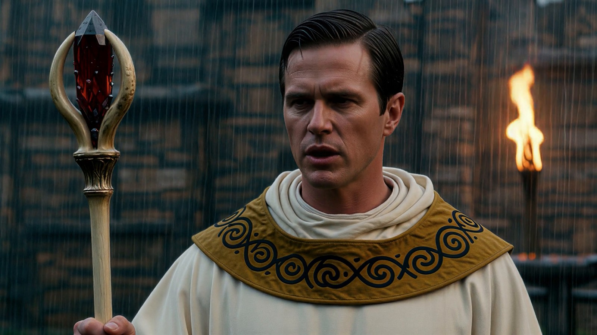
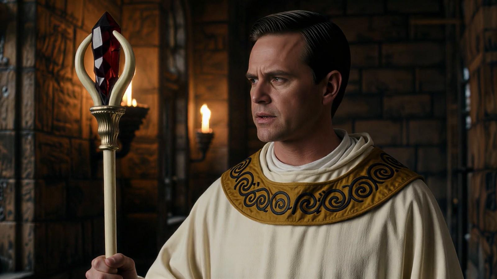
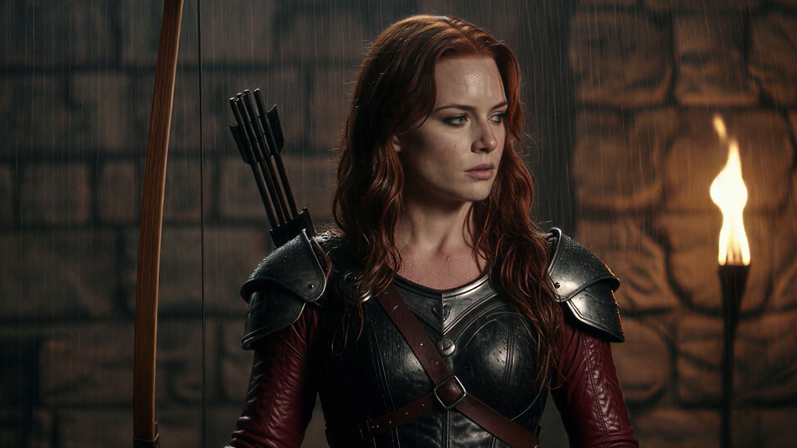
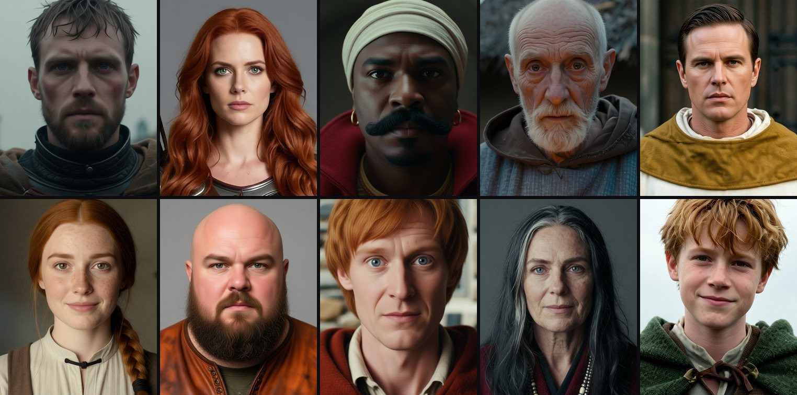
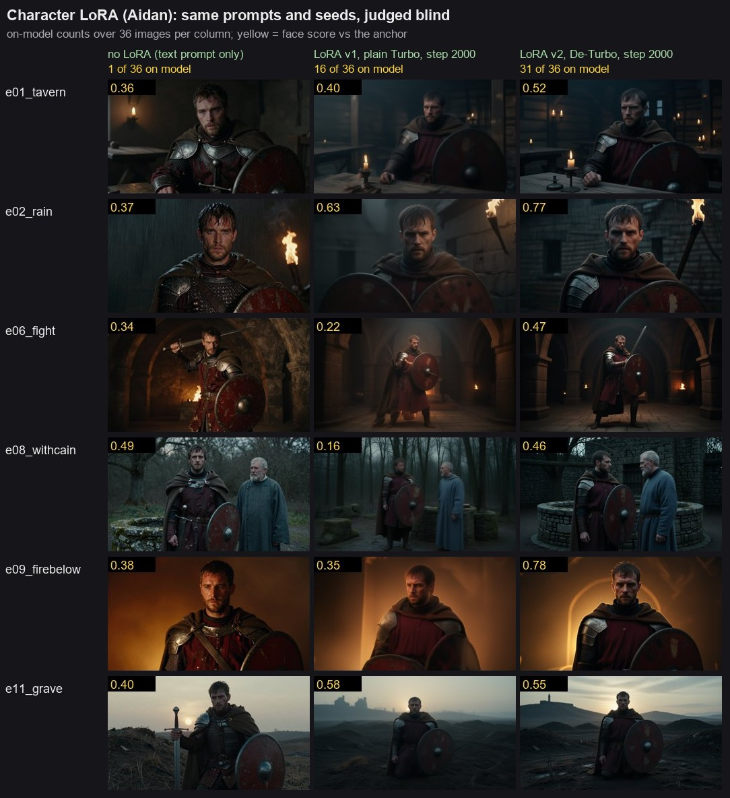
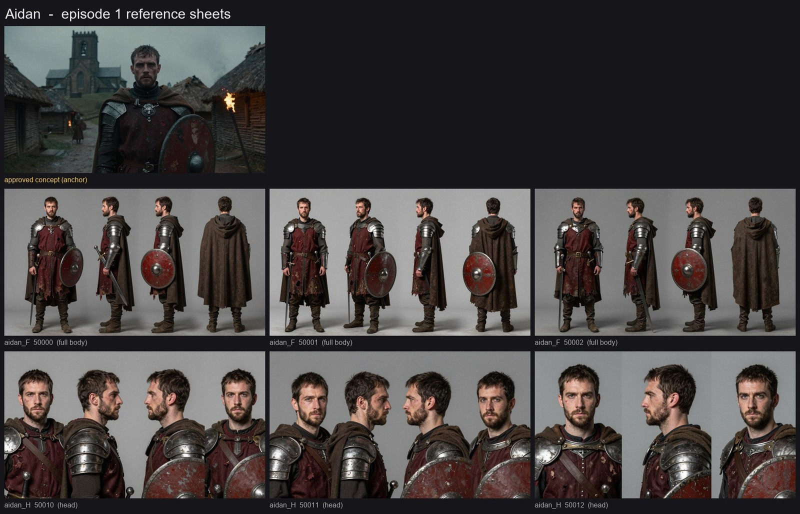

# ai-film-pipeline

A local AI film pipeline that takes a shot list to finished, sound-synced footage on one consumer GPU (RTX 4060 Ti, 8 GB). It produces still keyframes with Z-Image Turbo and keeps characters consistent with LoRAs trained on the same card. Wan 2.2 turns the stills into video, and SeedVR2 upscales the clips to 1080p. Sound is placed on the exact frame where it happens. No stage depends on a cloud service. A result counts only after it has been measured: method changes are tested against pass rules written down before the test, and every claim below comes with its number. The first production is a fan-film series retelling Diablo (1996) and Diablo II. Episode 1, "The Butcher" (15 minutes, 216 shots), is in production.

> These scripts are published as a portfolio/reference. They run against the project's own folders, models and shot lists, so they are not a turnkey library. The code is the documentation of the approach.

<p>
  
  
  
</p>

*Video frames (at 2.5 s) from the post-stage test. Each started as a character-LoRA keyframe, was animated with Wan 2.2 image-to-video and was upscaled with SeedVR2 3B. The first two show the same Lazarus LoRA in two different scenes, and the third shows Moreina's LoRA.*

| The cast | LoRA evaluation | Reference sheet |
|---|---|---|
|  |  |  |
| The current cast of episode 1: each face is defined once (a written character block, plus a LoRA where it beats the text) and held from shot to shot. | The same prompts and seeds with no LoRA, with LoRA v1 and with LoRA v2, all judged blind in one pass. | The approved concept (the LoRA anchor) with generated turnaround and head sheets. |

## Pipeline overview

```
beat sheet + shot list (about 5 s per shot: cast, place, sync points)
   │
   ▼
keyframes ── Z-Image Turbo, 1280x720, 8 steps, cfg 1                 run_shots.py keyframes
   │          + character LoRA (musubi-tuner, trained on De-Turbo)    train/
   │          blind AI judges gate the candidates
   ▼
image-to-video ── Wan 2.2 14B i2v, Q4 GGUF, Lightning 4-step,         run_shots.py video
   │              960x544, 81 frames at 16 fps
   │              clip QC by AI judges: pass / trim / retake           tools/clip_sheets.py, qc_*.py
   ▼
post ── SeedVR2 3B upscale to 1080p + RIFE frame interpolation        tools/seedvr2_post.py
   │
   ▼
sound ── spot every contact frame ─► one-shots placed per event (Foley)
   │     moving sources (pan, distance, doppler) and beds per location
   │     voice: Qwen3-TTS VoiceDesign      music: ACE-Step
   │                                        tools/spot.py kymo.py foley.py track.py move.py
   ▼
mix ── role-normalised cues, sidechain ducking, -14 LUFS               tools/mix.py
   │
   ▼
sync check by eye: picture over a scrolling waveform                    tools/synccheck.py
```

Everything runs through ComfyUI's HTTP API, headless (`--disable-auto-launch --reserve-vram 1.5`). The GPU is shared with other work, so long jobs run detached in queues with memory guards, and every script logs its own timings.

## Stages and key scripts

### 1. Keyframes: `run_shots.py`, `tools/`
- **`run_shots.py`** is the batch runner for keyframes, video and post. It reads a shot CSV (`id, image_prompt, motion_prompt, seed`, plus optional `width, height, lora, lora_strength, lora_steps, length`), submits API-format workflows and downloads the results per shot. `lora_steps=N` runs the LoRA on the first N of 8 steps only and lets the plain model finish: identity forms early and surface texture late.
- **`tools/build_concepts.py`** builds prompts from a "visual bible" of reusable description blocks and rejects any prompt with negations, text-bearing props or proper names, because Z-Image draws them.
- **`tools/concept_sheet.py`, `tools/edit_grids.py`** make contact sheets and labelled candidate grids for review.
- **`tools/run_edit.py`** runs batch edits with Qwen-Image-Edit-2511 (camera turns, expressions, poses). A memory monitor stops the batch on a VRAM spill, low RAM or pagefile growth, because on Windows a spill shows up as slowness, not as an error.
- **`tools/run_inpaint.py`, `tools/rect_composite.py`, `tools/run_img2img.py`** handle masked repaints, ECC-registered composites of edits back onto the original frame, and low-denoise passes.

### 2. Character LoRAs: `train/`
- **`train/train_character.py`** trains a Z-Image LoRA with musubi-tuner (rank 32, fp8, block swap) and converts each checkpoint for ComfyUI. It records the provenance of each run: data hash, base model and musubi commit.
- **`train/night_char.py`** runs one unattended night: training, then guards, then the evaluation renders, the sheets and blind copies for the judges. The guards stop on a VRAM spill measured against each process's settled level, on low RAM, a high commit charge, slow steps or the deadline. A no-LoRA control render confirms that the LoRA actually loaded.
- **`train/edit_session.py`, `train/select_char.py`, `train/build_lora_dataset.py`, `train/pilot/butcher/make_w1.py`** build the dataset. They take edit passes from one anchor image, have the judges keep or drop each result, and then select the images by shot type, place and light. Captions name only what varies, so the face and costume become part of the trigger word.
- **`train/judge_cands_char.js`, `train/judge_eval_char.js`** are the blind judge panels (see below). **`train/readout_char.py`** applies the pass rule: on model in 70% of images, a win over the no-LoRA baseline (exact McNemar test), photoreal style 7 or more, and artifacts held.
- **`train/baseline_check.py`** checks whether the text prompt alone already holds a character. A LoRA is trained only when it does not.
- **`train/texture_pass.py`, `train/texture_composite.py`, `train/composite_gate.py`** are the skin-texture experiments: a gated img2img pass and a skin-only composite, each followed by a blind visual gate.
- **`train/eval_sheet.py`, `train/make_eval_csv.py`** build the evaluation prompt sets and grids.

### 3. Video and post: `run_shots.py`, `train/`, `tools/`
- **`workflows/i2v_wan22_14b.json`** is the two-pass high/low-noise Wan 2.2 graph with the 4-step Lightning LoRAs.
- **`train/video_quality.py`, `train/seedvr2_test.py`** are test harnesses that compare settings ("arms") on the same keyframes and seeds, with a stall guard on each job.
- **`tools/clip_sheets.py`, `tools/qc_prep.py`, `tools/qc_save.py`** turn each clip into a 3x3 frame sheet for the QC judges and keep a retake queue.
- **`tools/post_manifest.py`, `tools/seedvr2_post.py`** pick the approved clip and usable span for each shot, trim it and upscale it with SeedVR2 (decode tiles of 256 px by 16 frames, which fit in 8 GB).
- **`tools/assemble.py`** cuts the clips together with crossfades. Every shot snaps to the output frame grid.

### 4. Sound: `tools/`
- **`tools/spot.py`** dumps numbered frames, contact sheets and a motion-energy curve so contact frames can be read off. **`tools/kymo.py`** draws height-against-time strips for dense action: each falling object leaves a diagonal, and the contact is where it goes flat.
- **`tools/oneshot_trim.py`** cuts library or generated clips into one-shots aligned on the transient. `--single` cuts before the first secondary bounce, so each sample is exactly one hit.
- **`tools/foley.py`** places one sample per spotted event (round-robin, with small gain and pitch variation). **`tools/track.py`** follows a sound source on screen, and **`tools/move.py`** renders it through pan, distance, air absorption and doppler automation. **`tools/move_check.py`** reads the render back and measures it against the automation.
- **`tools/mix.py`** is an ffmpeg mixer. It normalises each cue by role (with gated loudness for sparse sync stems), places cues to the sample, ducks music and ambience under the voice (optionally only in the speech band) and outputs -14 LUFS with a true-peak ceiling.
- **`tools/synccheck.py`** renders the picture over a scrolling waveform, with a playhead and a labelled line at every spotted frame, so sync can be judged by eye.
- **`tools/gen_voice_qwen.py`, `tools/voice_casting.py`, `tools/gen_music.py`** generate voice and music locally. The other `gen_*` scripts are the voice, music, sound-effect and video-to-audio models that were compared along the way.

### 5. Queueing: `train/`
- **`train/chain.py`** runs GPU jobs one after another, detached, each with its own log. It supports `wait_pid` and relative deadlines. **`train/queue_after.py`** starts the next job when a marker appears in a log. **`train/comfy_run.py`** starts ComfyUI, runs one job and stops ComfyUI again.

## How decisions are made: blind judge panels

The judges are **AI agents (Claude subagents)**, not people. Workflow scripts such as `train/judge_eval_char.js` spawn them and give each one a group of images under neutral codes in shuffled order. ComfyUI metadata is stripped from the copies, so a judge cannot read which LoRA made an image. Each judge returns a fixed schema (identity, costume, prompt following, artifacts, photoreal style, extra objects). The pass rule is written down before the first image exists, and only comparisons judged in the same pass are trusted, because the same images scored between 5 and 12 of 36 apart in separate panels. Clip QC works the same way: two judges look at each clip's frame sheet, and a third, skeptical agent re-checks every flagged fault. Final creative picks are made by hand, from cards that show the measured options.

## Measured results

| What | Result | Context |
|---|---|---|
| Sound sync accuracy | **72 of 72** spotted events start within one frame (31 ms) of their picture frame; 96% within 15 ms; median +1 ms | 65 s, 14-shot test trailer. Measured on the final render at the attack point, with the whole chain calibrated with test clicks |
| Placed one-shots vs AI video-to-audio | **17/23** impacts within 50 ms (median 10 ms) vs **3/23** for MMAudio (median 250 ms, which also produced only 7 transients) | One shot of the test trailer with 23 spotted impacts |
| Library one-shots vs generated | 22/32 usable impact one-shots from library recordings vs 9/24 generated with AudioLDM2 | Sample pools for that shot |
| Character LoRA, training base | **29-33 of 36** images on model with v2 (De-Turbo) vs 12-16 with v1 (plain Turbo) and 1 of 36 for the text prompt alone; both main comparisons p < 0.001 | Aidan, 12 scenes x 3 seeds, judged blind in one pass |
| Best character LoRA | **34 of 36** on model vs 12 of 36 without the LoRA (p < 0.0001) | The Butcher, step 2000 |
| LoRA pass rate | **2 of 9** characters passed every pre-set rule. 3 more failed on the photoreal bar (2 of them also on extra objects) but hold identity far better than text, so they are used with the render-side fixes below. 4 use their text prompt instead | Aidan, Butcher, Moreina, Lazarus, Wirt, Jazreth, Cain, Gillian, Griswold |
| LoRA on early steps only (`lora_steps=6`) | +0.53 photoreal; on model -1 and -3 of 36 | Lazarus |
| SeedVR2 3B vs NMKD-Siax upscaler | photoreal **5.00 to 7.33**, preferred in 12 of 12 verdicts; LoRA shots 4.83 to 7.33 and text-only shots 5.17 to 7.33. Confirmed on a second character, Moreina: 4.92 to 6.75 | 6 clips per test, 2 judges per clip |
| Video settings | No alternative beat 960x544 with 4 Lightning steps. 1280x720 gave +0.42 photoreal but only 3 s clips at 4.4x the GPU time per second; 8 steps added nothing | 6 shots, blind |
| Video prompt rules | usable clips: 4/10 with the old prompt and a new seed, 8/10 with prompts rewritten by QC-derived rules, 7/9 with rewritten prompts and clip length = shot length + 0.5 s; clean passes 3 / 3 / 6 | 10 failed shots of episode 1 |
| Clip QC, round 1 | 70 clips: 27 pass, 13 trim, 30 retake | Episode 1 |
| Skin fix, identity kept | "same person: yes" 46/56 for a skin-only composite vs 44/56 for the originals and 21/56 for a full img2img pass | Moreina, blind visual gate |
| Face-score validation | AuraFace AUC 0.975 against the user's labels; a 0.45 threshold gives 95% precision | Aidan |
| Concept round | 681 keyframes for 31 subjects in three rounds; 22 subjects at 8/10 after round 3 | Look development |
| Episode 1 status (2026-10-13) | 210 of 216 keyframes approved; 113 shots have an approved clip | Picture first, then voice, music and the mix |

## Lessons learned

**Z-Image word traps.** The text encoder takes words literally, and a cfg of 1 gives no second chance.
- Colour words become substances: "blood-red" puts blood in the frame. Put the colour in a light source instead, such as a crimson sunset or a brazier behind the subject.
- "Medieval" defaults to tidy 16th to 19th-century England, "lantern" gives a kerosene lamp, "cathedral" gives Salisbury and "hulking" gives a bodybuilder. Describe the detail you want (wattle hovels, an iron candle lantern, an abbey church with one square tower, a heavy belly).
- A look block at the end of a prompt only changes the grade. Different looks need their own camera, lens and light source in the shot line.
- Negations backfire because the named thing tends to appear. Text-bearing props come out as gibberish, and character names do nothing. `build_concepts.py` rejects all three.
- A light prop in the frame rarely lights a face. With a character LoRA, anatomy words override the trained look, so prompts carry only the trained wording.

**Negative prompts do nothing at cfg 1.** The Lightning LoRAs for Wan and the Turbo models run at cfg 1, so the negative text encode is ignored. Time spent on negative prompts is wasted; rewrite the positive prompt instead.

**AI-video traps.**
- **Wan decodes in chunks of 4 source frames.** At 32 fps the whole picture jumps slightly on frames 1, 9, 17 and so on, and the motion curve peaks there. A peak on a chunk frame is never an event by itself. The interpolated frames are invented, so fine timing is confirmed on the 16 fps source, and the real precision is one source frame (62.5 ms).
- **Empty scenes get populated.** In the test trailer, every shot with no person in it had a figure walk in after about 2.5 s, in 6 of 6 takes, and writing "nobody appears" made it worse. In episode 1 the QC judges found invented people and modern things (a sedan, a modern suit) near doors and lanes, and extra actions starting after about 2.8 s. The fixes are to put a subject in the shot, to end it early, and to make the clip length the shot length plus 0.5 s.
- **Faces need pixels.** Faces at 832x480 turn to mush, and an upscaler only sharpens the mush. Rendering face shots at 960x544 fixes it, while 1280x720 at 81 frames does not fit in 8 GB.
- **Time sounds against the frame the picture shows.** The joiner snaps every shot to the output frame grid, up to 12.5 ms off its nominal start, so cue starts are snapped the same way.

**Sound.** An AI clip has its own random internal timing, so a generated "footsteps" sound never lines up with the picture. The fix is structural: spot every contact frame, have a second pass check the spotting, and place one sample per event. Every sample must hold exactly one hit (20 of 22 library casing recordings had their own bounces inside). Only what is visible gets synced, and a sound without a sync point must never mask sounds that have one. Audiences notice sound that arrives early from about 45 ms, but they tolerate about one frame late.

**Character LoRAs.**
- **Check that the adapter actually loads.** The training adapter of the first runs merged 0 modules, so those runs were plain Turbo training, which is soft at 8 steps. Training on De-Turbo moved Aidan from 12-16 to 29-33 of 36 on model.
- **Test the text prompt first.** For four characters the text prompt alone beat the LoRA (Cain: 32 of 36 for text vs 1 to 3 for the LoRA).
- **Datasets teach what they show.** Close-ups with no headroom taught Griswold's LoRA to crop his head off (15 of 36). An uncaptioned hood taught Cain's LoRA to raise a cowl. Anchor flaws copied into 44 of 46 edits for one character.
- **Use one LoRA per frame.** A second character in the same frame picks up the other character's features.
- **Fix the gloss at render, not in the data.** The edit model's airbrushed skin carries into the LoRA. Every training-side fix failed (strength, captions, skin composites, re-renders). The fixes that work are `lora_steps=6` at render and SeedVR2 at post.

**Operations.** ComfyUI's pinned memory shows up in Windows as shared GPU memory from the moment it starts, so a VRAM-spill guard has to measure the rise above each process's settled level. Group edit jobs by LoRA setting, because every LoRA switch re-patches the model.

## Hardware and timings

RTX 4060 Ti 8 GB, ComfyUI portable, everything local. Times are measured on this card.

| Job | Time |
|---|---|
| Keyframe, Z-Image Turbo 1280x720, 8 steps | 7-15 s (7.0 s with `--poll 1`) |
| Image edit, Qwen-Image-Edit-2511 Q4 + Lightning, about 1 MP | median 48.5 s (39 edits) |
| Video clip, Wan 2.2 14B Q4, 81 frames | 4.3 min at 832x480; 5.5-6.5 min at 960x544 |
| SeedVR2 3B upscale to 1080p | about 7 min per 5 s clip |
| Old post: 4x NMKD-Siax + RIFE 2x | about 4 min per clip |
| LoRA training, musubi-tuner, rank 32 | 5.5-7.0 s per step; 2,000-2,500 steps in about 3.5-4 h |
| Video-to-audio, MMAudio | 19 s per 5 s clip, 5.8 GB VRAM |

Training speed against block swap (50 steps, from step 10 on): at 640 px, 24 swapped blocks give 5.12 s/step at 4.1 GB peak VRAM, and 16 blocks give 4.76 s/step at 5.6 GB. At 1024 px, 24 blocks give 11.98 s/step. Edit runs hold about 19-20 GB of system RAM.

## Commercial licence checks

Every model, upscaler and sound source was checked for commercial use before it entered the pipeline:
- **4x-UltraSharp was dropped** because it is CC BY-NC-SA. NMKD-Siax (WTFPL) replaced it, and SeedVR2 3B (Apache 2.0) later replaced that.
- **MMAudio (CC BY-NC) and AudioLDM2 (CC BY-NC-SA)** were used only for measurement. Their output never goes into a published film.
- **Face scoring avoids the InsightFace model zoo** (non-commercial weights). It uses AuraFace glintr100 (Apache 2.0, hash-pinned) and OpenCV YuNet/SFace. Face-swap and face-restore models with non-commercial weights are not used anywhere in the pipeline; the ReActor face-swap workflow was disabled and is not included.
- Z-Image Turbo, Z-Image De-Turbo, Qwen-Image-Edit-2511 with its Lightning and multiple-angles LoRAs, and Wan 2.2 are Apache 2.0. `train/download_lora_models.py` pins every download to its published SHA256.
- Library sounds are logged per file with their licences. The fan films use no original game music or voice lines and no cloned voice actors, and they paraphrase the game's story.

## Running it (for reference)

Windows, Python 3, ComfyUI portable with the GGUF, VideoHelperSuite and Frame-Interpolation custom nodes, and musubi-tuner in its own venv. Paths come from environment variables. Their defaults assume the tools sit next to the project folder:

| Variable | Default |
|---|---|
| `PROJECT_ROOT` | this repository |
| `COMFY_ROOT` | `../ComfyUI_windows_portable` |
| `MUSUBI_ROOT` | `../musubi-tuner` |
| `AUDIO_ROOT` | `../audio` (venvs for TTS, music and video-to-audio) |

The ComfyUI scripts run with the ComfyUI portable Python, and the audio-analysis scripts (`oneshot_trim.py`, `move.py`) run with the audio venv. The repository includes no models, datasets, renders, audio or story documents.

## Context

Diablo is a trademark of Blizzard Entertainment. This is an unaffiliated fan project. Each film will say that it uses AI and that it is not affiliated with Blizzard.

**Designed, directed and measured by Barış Sabuncular; code written with AI coding agents (Claude Code).**

## License

MIT. See [LICENSE](LICENSE). No models, datasets or media are included.
